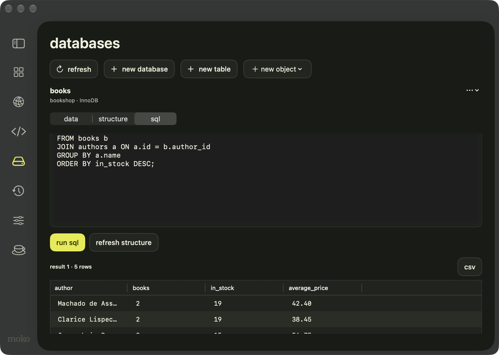
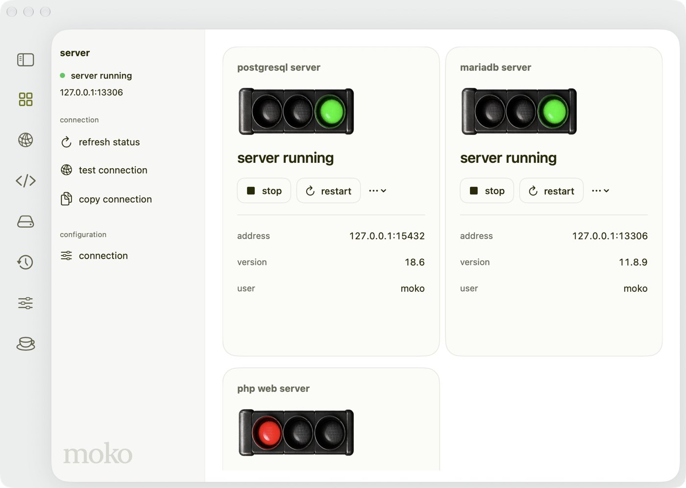

# moko

A local development environment for macOS. moko ships PostgreSQL, MariaDB and PHP ready to use, connects to
servers you already have and includes a database browser, all in one native app.

## What it does

- **Included servers:** PostgreSQL 18, MariaDB 11.8 and PHP 8.4, each with its own start and stop buttons.
  No Homebrew, no terminal and no administrator installer.
- **Existing servers:** connects to local or remote PostgreSQL, MariaDB and MySQL.
- **Database browser:** tables, columns, indexes, keys, views, procedures, functions, triggers and events,
  with forms that show the SQL before applying it.
- **SQL console:** run scripts, keep a history, export CSV, export and import databases.
- **PHP projects:** pick the folder, the port and the project database; moko runs the development server.
- **AI agents (optional):** a built-in MCP server lets agents such as Claude Code read the structure of your
  databases and run SQL on your connections, read only by default.

| Data | SQL console |
| --- | --- |
|  |  |

| Light theme | First launch |
| --- | --- |
|  |  |

## Requirements

macOS 26 or later on Apple Silicon. See the [user guide](docs/user-guide.md) and
[installation](docs/installation.md).

There is no signed and notarized public download yet.

## Source

| Folder | Contents |
| --- | --- |
| `App/Sources` | Application code: models, servers, C bridges and SwiftUI views |
| `App/Resources` | Assets, icon and legal texts |
| `App/Tests` | Check executables and interface tests |
| `App/Config` | Info.plist, build settings and pinned runtime manifests |
| `App/Support` | Build scripts, including the runtime bootstrap and recipes |
| `docs` | User guide and installation |

`App/project.yml` describes the Xcode project ([XcodeGen](https://github.com/yonaskolb/XcodeGen));
`App/moko.xcodeproj` is generated from it. `App/Config/Runtime.lock.json` pins every runtime component,
its version and its upstream source.

## Building

Requirements: Apple Silicon, macOS 26 or later, Xcode 26, Python 3.9 or later and XcodeGen 2.46 or later.
SwiftLint is optional.

The app embeds PostgreSQL, PHP and MariaDB runtimes that are not stored in Git. Fetch them once into
`Local/Runtime`:

    python3 App/Support/bootstrap-runtime.py

This downloads the development payload pinned in `App/Config/Runtime.payload.json` and verifies its
SHA-256. To rebuild every runtime from the published upstream sources instead (slow; also needs CMake and
make):

    python3 App/Support/bootstrap-runtime.py --from-source

The PostgreSQL runtime is built with `make world-bin`, so every contrib extension (pgcrypto, uuid-ossp,
pg_trgm, citext, unaccent, hstore and the rest) is available to `CREATE EXTENSION`. After rebuilding,
`--from-source` regenerates `App/Config/Runtime Inputs.xcfilelist`; publish the result with
`--package OUT` and upload it under a new `dev-runtime-*` release tag.

Then generate the project and build:

    cd App && xcodegen && xcodebuild -project moko.xcodeproj -scheme moko -configuration Debug build

`python3 App/Support/bootstrap-runtime.py --check` reports what `Local/Runtime` is missing. The targets
sign with an Apple Development certificate; put your own settings in `Local/Signing/Signing.xcconfig`, or
pass `CODE_SIGN_IDENTITY=-` to `xcodebuild` for an ad hoc build. The build recipes live in
`App/Support/Runtime`, and the corresponding source of every bundled binary is attached to the
[runtime sources release](https://github.com/otavioaugustosw/moko/releases/tag/runtime-sources-2026-10-12).

## License

moko is free software: GNU General Public License, version 3 or later. See [LICENSE](LICENSE) and
[NOTICE](NOTICE.md) for the name, the artwork, the author's portrait and third-party trademarks. This
repository contains no third-party binaries.
