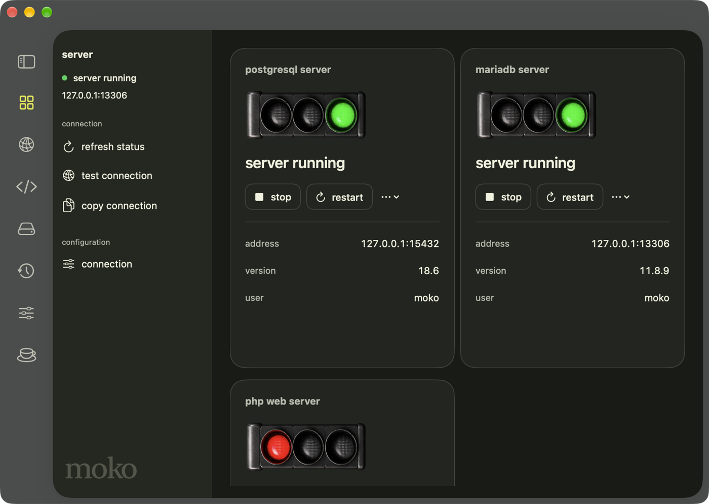
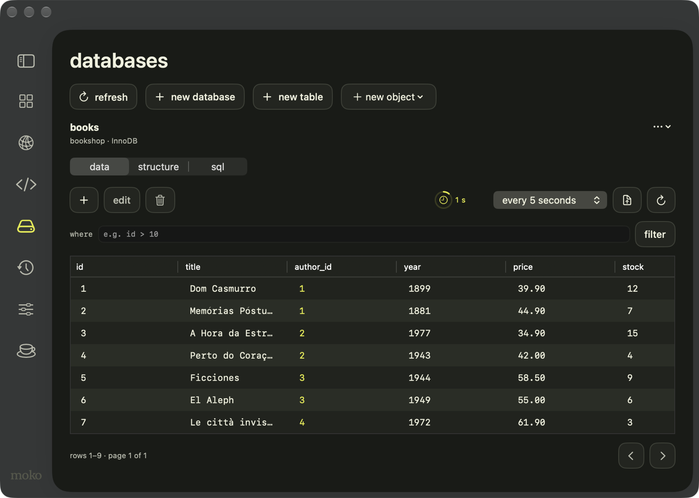

# moko

A local development environment for macOS. moko ships PostgreSQL, MariaDB and PHP ready to use, connects to
servers you already have and includes a database browser, all in one native app.

## What it does

- **Included servers:** PostgreSQL 18, MariaDB 11.8 and PHP 8.4, each with its own start and stop buttons.
  No Homebrew, no terminal and no administrator installer.
- **Existing servers:** connects to local or remote PostgreSQL, MariaDB and MySQL.
- **Database browser:** tables, columns, indexes, keys, views, procedures, functions, triggers and events,
  with forms that show the SQL before applying it.
- **SQL console:** run scripts, keep a history, export CSV, export and import databases.
- **PHP projects:** pick the folder, the port and the project database; moko runs the development server.
- **AI agents (optional):** a built-in MCP server lets agents such as Claude Code read the structure of your
  databases and run SQL on your connections, read only by default.

| Data | SQL console |
| --- | --- |
|  |  |

| Light theme | First launch |
| --- | --- |
|  |  |

## Requirements

macOS 26 or later on Apple Silicon. See the [user guide](docs/user-guide.md) and
[installation](docs/installation.md).

There is no signed and notarized public download yet.

## Source

| Folder | Contents |
| --- | --- |
| `App/Sources` | Application code: models, servers, C bridges and SwiftUI views |
| `App/Resources` | Assets, icon and legal texts |
| `App/Tests` | Check executables and interface tests |
| `App/Config` | Info.plist, build settings and pinned runtime manifest |
| `docs` | User guide and installation |

`App/project.yml` describes the Xcode project ([XcodeGen](https://github.com/yonaskolb/XcodeGen));
`App/moko.xcodeproj` is generated from it. The app embeds prebuilt PostgreSQL, PHP and MariaDB runtimes
from `Local/Runtime`, which is not part of this repository, so a fresh clone does not build as it is.
`App/Config/Runtime.lock.json` pins every runtime component, its version and its upstream source.

## License

moko is free software: GNU General Public License, version 3 or later. See [LICENSE](LICENSE) and
[NOTICE](NOTICE.md) for the name, the artwork, the author's portrait and third-party trademarks. This
repository contains no third-party binaries.
